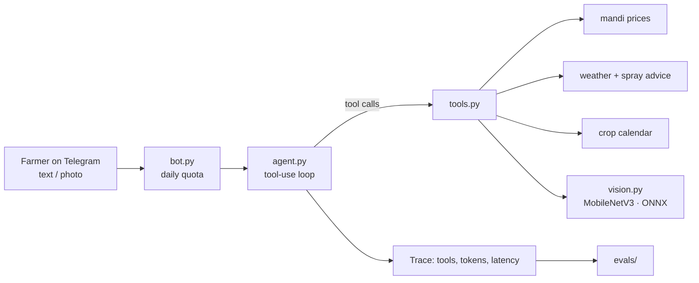

# kisan-agent 🌱

A farmer's assistant on Telegram that answers in **Hindi, Hinglish or English**: *"what's wrong with my leaf?"*, *"where do I sell?"*, *"can I spray tomorrow?"*. It's built on a hand-written Claude tool-use loop, my own [mandi-mcp](https://github.com/Shriniwas2412/mandi-mcp) tools, and a leaf-disease classifier I trained on real field photos.

> Built on field work with 100+ farmers on crop-disease AI (patent filed: ForestFlyer/EcoSentry agri-drone).



## Leaf-disease classifier: results
MobileNetV3-Small (ImageNet-pretrained), fine-tuned for 25 epochs on **PlantDoc**: 2,336 real field photos, 28 classes (13 crops), cluttered backgrounds. Trained on an M1 MacBook (MPS) in 39.5 min; the ONNX model is 6 MB and runs on CPU.

| Metric (official PlantDoc test split, 236 images) | Value |
|---|---|
| Top-1 accuracy | **42.8%** |
| Top-3 accuracy | **77.1%** |
| Coverage at confidence ≥ 0.6 | 28.8% of photos |
| Accuracy on those confident photos | **76.5%** |

| Confidence threshold | 0.4 | 0.5 | **0.6 (used)** | 0.7 |
|---|---|---|---|---|
| Coverage | 71.6% | 47.0% | 28.8% | 14.4% |
| Accuracy when confident | 55.0% | 68.5% | 76.5% | 73.5% |

**What this means:** on its own the model is a weak diagnostician, as expected for about 80 noisy photos per class. But it **knows when it's unsure**. The agent only names a disease when confidence is ≥ 0.6 (threshold fixed before evaluation). Otherwise it says it's unsure, offers the top possibilities, and asks for a clearer close-up. Every answer points to the KVK.

Weakest classes: tomato early blight, mosaic virus and mold (0 of 25 test images right), which are visually similar tomato diseases. Strongest: raspberry and strawberry (15/15), grape, squash powdery mildew, corn rust. Per-class test sets are only 4–12 images, so per-class numbers are noisy.

Reproduce:
```bash
pip install -e ".[train,vision]"
python training/train_leaf.py --data path/to/PlantDoc-Dataset --epochs 25   # → models/
python training/eval_onnx.py --test path/to/PlantDoc-Dataset/test
```

**Next:** train on leaf crops (less background), try EfficientNet-B0, add test-time augmentation, and calibrate confidences (temperature scaling) so the 0.6 threshold means what it says.

## Status
| Piece | State |
|---|---|
| Agent loop (parallel tool calls, turn cap, refusal handling, traces) | ✅ |
| Tools: mandi prices, best mandi, weather, crop calendar | ✅ via mandi-mcp |
| Leaf classifier (ONNX) + selective prediction | ✅ results above |
| Telegram bot: text + photo, 20 questions/user/day | ✅ |
| Eval suite (12 cases: routing, Hindi, safety) | ✅ written; live results pending |
| Voice notes (Hindi speech-to-text) | ⏳ next |
| Public deployment + demo video | ⏳ next |

## Run it
```bash
pip install -e ../mandi-mcp -e ".[dev,vision,bot]"
cp .env.example .env     # ANTHROPIC_API_KEY, DATA_GOV_IN_API_KEY, TELEGRAM_BOT_TOKEN
set -a; source .env; set +a

kisan "Sehore mein gehun ka bhav kya hai?"   # one question in the terminal
kisan-bot                                     # Telegram bot (token from @BotFather)
pytest                                        # 14 offline tests, no API key needed
```
The trained model (`models/leaf_classifier.onnx` + `labels.json`) is attached to the GitHub Release; download it into `models/`.

## Design decisions
- **No agent framework.** The loop is about 60 lines in `agent.py`, so every request, tool call and stop reason is visible and testable.
- **Tool results go back in one message** so the model can check weather and prices in parallel.
- **Hard turn cap (8)** and a **per-user daily quota** keep a confused agent or a spammer from running up the bill.
- **Honest failure.** No model file, an unreadable photo, or an API outage each return an explicit error the agent must relay, never a guess.
- **Privacy.** The bot logs tool names, tokens and latency only, never farmers' messages or photos.
- **Model:** `claude-opus-5-5` by default; set `KISAN_MODEL=claude-haiku-4-5` for a cheaper public demo and compare them with the eval suite.

## Data
PlantDoc: Singh et al., *"PlantDoc: A Dataset for Visual Plant Disease Detection"*, CoDS-COMAD 2020, licensed CC BY 4.0.

## License
MIT © Shriniwas Maheshwari
